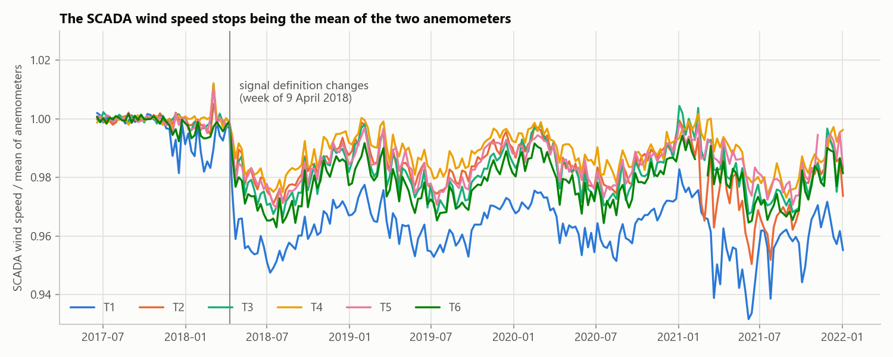
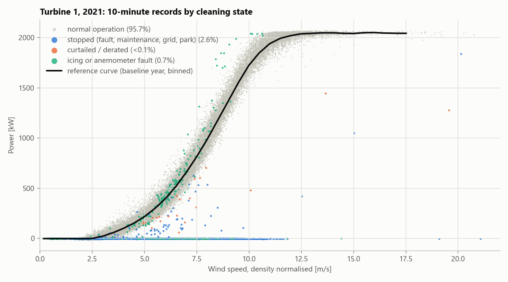
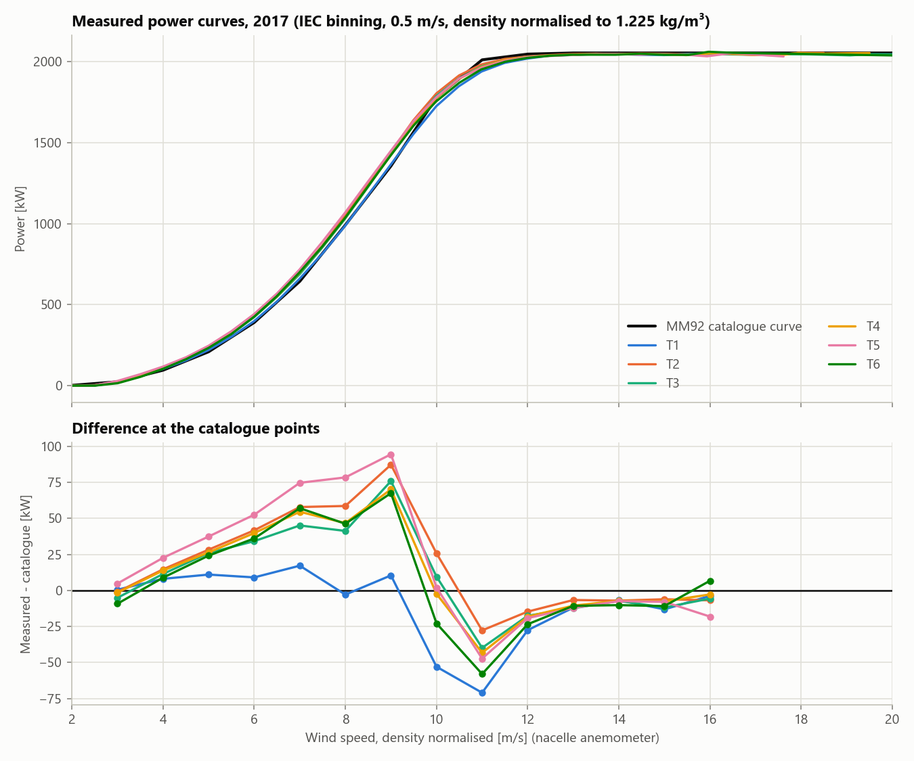
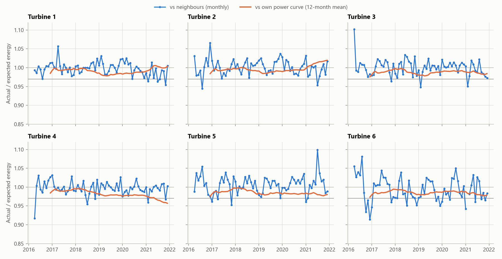
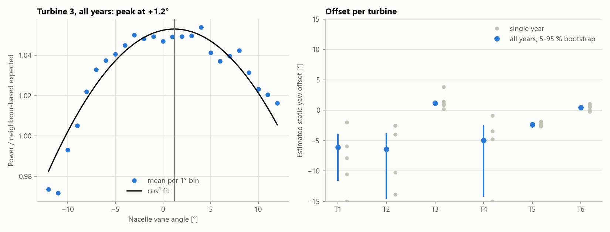
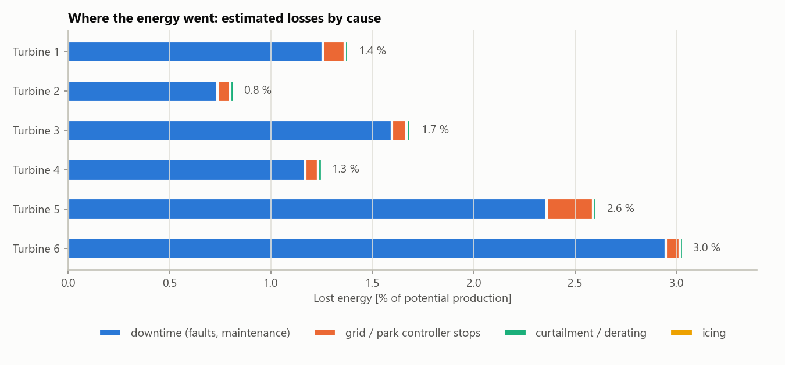

# Wind turbine power curves and underperformance on open SCADA data


Performance analysis of the **Kelmarsh wind farm** (UK, 6 x Senvion MM92, 12.3 MW) from its open 10-minute SCADA
data, 2016-2021: data cleaning with the turbines' own event logs, **power curves following IEC 61400-12-1**
(air density normalisation, method of bins, AEP), comparison of the six turbines with each other and with the
manufacturer's catalogue curve, **underperformance tracking** against two independent references, **static yaw
misalignment** from the nacelle vane, and an estimate of the **energy lost** to downtime, grid stops and
curtailment.

## Key results (15 Apr 2016 - 31 Dec 2021, 1.8 million 10-minute records)

- **96.4 %** of the records after commercial operation are normal operation; the rest are stops (1.6 %), missing
  data (1.6 %), grid / park controller stops (0.2 %), anemometer faults (0.2 %), curtailment (0.05 %) and icing
  (0.01 %).
- **No measurable degradation.** Relative to its neighbours, every turbine's long-term trend lies within
  ±0.3 % per year and none differs from zero at 95 % confidence (69 months).
- **A data trap, caught.** In April 2018 the SCADA wind speed silently changed definition. Used as is, it makes
  the turbines look up to 14 % *better* than in 2017 (T1: power curve index 1.135 in 2021 vs 0.999). Rebuilt
  from the two anemometers, the "improvement" disappears, and the turbines' production relative to each other
  confirms nothing changed.
- **Power curves** measured on the nacelle anemometers give 2-4 % more AEP than the MM92 catalogue curve on five
  turbines and the same on T1, the usual optimism of nacelle anemometry rather than better turbines.
- **Static yaw misalignment** is small: T3 +1.2°, T5 -2.4°, T6 +0.5° with tight intervals; T1, T2 and T4 point to
  -5° to -6° but are poorly determined. Estimated cost: at most 0.35 % of partial-load energy.
- **Lost energy: 3.1 GWh, 1.7 % of potential production** (energy-based availability 98.3 %), 93 % of it
  downtime. T6 and T5 lose most (3.0 % and 2.6 %), largely through long stops in 2021, the worst year
  (availability 95.8 %).

### 1. The wind speed signal changes in April 2018

Until early April 2018 the SCADA `Wind speed` equals the mean of the two nacelle anemometers (ratio 1.000 to the
third decimal). From the week of 9 April 2018, on all six turbines at once, it follows the lower-reading sensor
2 and sits 1-7 % below that mean, most of all on T1, whose sensor 1 reads 7.5 % above sensor 2 (median; 2-4 %
on the other turbines).



With the turbine's own power curve as the reference that looks like a large performance gain; the
anemometer-independent comparison with the neighbours shows nothing of the kind:

| Annual index (actual / expected, partial load) | T1 | T2 | T3 | T4 | T5 | T6 |
|---|---|---|---|---|---|---|
| own power curve, raw SCADA wind speed, 2019 | 1.092 | 1.034 | 1.046 | 1.009 | 1.030 | 1.052 |
| own power curve, consistent wind speed, 2019 | 0.986 | 0.991 | 0.991 | 0.979 | 0.986 | 0.990 |
| vs neighbours, 2019 | 1.004 | 1.010 | 0.994 | 1.002 | 1.000 | 0.988 |
| own power curve, raw SCADA wind speed, 2021 | 1.135 | 1.091 | 1.041 | 0.995 | 1.026 | 1.045 |
| own power curve, consistent wind speed, 2021 | 1.008 | 1.021 | 0.988 | 0.959 | 0.982 | 0.985 |
| vs neighbours, 2021 | 0.983 | 0.996 | 0.990 | 0.993 | 1.006 | 0.986 |

The remaining 1-2 % offset of the power curve index after 2017 is common to all turbines, so it reflects the
conditions a nacelle-anemometer power curve is sensitive to (it also swings with the season, section 4), not the
turbines themselves. In 2021 the two indices still disagree on T1, T2 and T4, which is when the status logs
report repeated *Anemometer defect* and *4-20mA anemometer* alarms on T1, T4 and T5.

### 2. Data cleaning



Stops sit on the zero line; the green points above the curve are records where the two anemometers disagree, so
the wind speed is too low for the power produced.

### 3. Power curves vs the catalogue curve



Baseline year 2017, all six databases complete by the IEC criteria (8,360-8,540 hours of normal operation each).
AEP relative to the same AEP from the MM92 catalogue curve (5,281 / 7,030 / 8,581 MWh per year):

| Rayleigh mean wind speed | T1 | T2 | T3 | T4 | T5 | T6 |
|---|---|---|---|---|---|---|
| 6 m/s | 0.996 | 1.042 | 1.030 | 1.033 | 1.052 | 1.027 |
| 7 m/s | 0.994 | 1.031 | 1.022 | 1.024 | 1.037 | 1.018 |
| 8 m/s | 0.993 | 1.024 | 1.016 | 1.017 | 1.027 | 1.013 |

The surplus sits in partial load (5-9 m/s), where a nacelle anemometer behind the rotor reads below the
free-stream wind; at 11-12 m/s, just below rated power, the measured curves are 15-70 kW *below* the catalogue.
T1's lower curve matches its higher-reading sensor 1, so it is more likely anemometer calibration than turbine
performance; settling that needs a met mast or a lidar. The two turbines on 68.5 m towers (T3, T6) do not stand
out from the four on 78.5 m. Per-year curves are in `results/power_curves_by_year.csv` and per-year AEP ratios in
`results/aep_vs_catalogue.csv`.

### 4. Underperformance over time



The neighbour index (blue) stays around 1.0 for every turbine. The monthly power curve index swings by about
±5 % with the season (roughly 0.91-0.97 in summer and 1.00-1.09 in winter; the chart shows its 12-month mean),
so on its own it cannot detect changes of a few percent.

| | T1 | T2 | T3 | T4 | T5 | T6 |
|---|---|---|---|---|---|---|
| trend vs neighbours [% / year] | -0.18 | -0.05 | -0.10 | -0.09 | +0.07 | -0.27 |
| 95 % confidence interval | -0.45 / +0.08 | -0.36 / +0.25 | -0.41 / +0.16 | -0.34 / +0.13 | -0.28 / +0.40 | -0.80 / +0.23 |

Three episodes of two or more months below 0.97 were flagged. None is confirmed by the power curve index
relative to the farm, i.e. in each case the turbine turned the wind it received into power as usual:

| Turbine | Months | Index vs neighbours | Power curve index vs farm | Reading |
|---|---|---|---|---|
| T6 | Oct 2016 - Jan 2017 | 0.940 | 0.995 | most likely received less wind than its neighbours: T6 has a lower hub (68.5 m), and stable winter conditions with strong shear favour the taller towers |
| T6 | Dec 2019 - Jan 2020 | 0.956 | 1.004 | the same pattern, again in winter |
| T1 | Jul - Aug 2021 | 0.966 | 1.000 | not conclusive: T1's anemometer 2 was faulty in 2021, so the power curve check itself is unreliable; T1's neighbour index for the whole of 2021 is 0.983 |

### 5. Static yaw misalignment



| | T1 | T2 | T3 | T4 | T5 | T6 |
|---|---|---|---|---|---|---|
| offset, all years [°] | -6.1 | -6.4 | +1.2 | -4.9 | -2.4 | +0.5 |
| 5-95 % bootstrap [°] | -11.6 / -3.9 | -14.6 / -3.8 | +0.9 / +1.6 | -14.2 / -2.4 | -2.9 / -2.0 | 0.0 / +0.8 |
| energy cost in partial load [%] | 0.35 | 0.34 | 0.06 | 0.20 | 0.20 | 0.01 |

A lopsided interval (T1, T2, T4) means the power ratio is nearly flat over the observed vane range, so the peak
is poorly located. These turbines are worth a check with a better reference (spinner anemometer or lidar)
before anyone corrects a vane offset.

### 6. Lost energy



| Year | Production [MWh] | Lost [MWh] | of which downtime | Energy availability | Capacity factor | Turbine-hours without data |
|---|---|---|---|---|---|---|
| 2016 (from 15 Apr) | 18,160 | 196 | 125 | 98.9 % | 23.6 % | 885 |
| 2017 | 32,561 | 396 | 334 | 98.8 % | 30.2 % | 633 |
| 2018 | 30,189 | 371 | 355 | 98.8 % | 28.0 % | 1,894 |
| 2019 | 30,893 | 189 | 162 | 99.4 % | 28.7 % | 70 |
| 2020 | 36,501 | 723 | 704 | 98.1 % | 33.8 % | 464 |
| 2021 | 27,913 | 1,231 | 1,212 | 95.8 % | 25.9 % | 696 |

2021 combines a low-wind year with two long outages: a 25-day maintenance stop on T6 in
February-March after *Max. drivetrain oscillations* alarms, and an 11-day stop on T5 in November after converter
and UPS faults. A farm-wide 77-hour park controller stop in August 2021 counts as a grid / park stop.

The operator's own system (Greenbyte) attributes 5.6 GWh to downtime over the same period. 2.3 GWh of that
falls into the 4,641 turbine-hours of SCADA gaps without any wind data (October 2018 is the largest), which this
analysis leaves unallocated instead of guessing; estimating them would need an external wind source such as
ERA5. Outside the gaps the two estimates agree within 7 % (Greenbyte 3.3 GWh, here 3.1 GWh of downtime plus
grid / park stops).

## Method

### Data and cleaning

Each 10-minute record gets exactly one state; only `normal` records are used for power curves and performance
indices.

| State | Rule |
|---|---|
| `pre_cod` | before the commercial operation date (15 April 2016) |
| `missing` | no wind speed or no power |
| `sensor` | anemometer fault: out of range, frozen for 30 min, or the two anemometers disagree by > max(1 m/s, 15 %) |
| `stop_grid` | a `Stop` event in the status log with IEC category *Out of Electrical Specification* or *Requested Shutdown* (grid loss, park controller) |
| `stop` | any other `Stop` event, or power <= 0 at >= 4.5 m/s without an event |
| `curtailed` | a power-reduction event in the log, or blades pitched > 4 deg above the turbine's median pitch for that wind speed while power is < 85 % of the median |
| `icing` | nacelle temperature <= 2 degC and power < 70 % of the turbine's warm-weather median curve |
| `normal` | everything else |

Status events are matched to 10-minute intervals by overlap (an event from 10:05 to 10:12 marks the 10:00
interval). For the reference curves only, points further than 4 robust standard deviations (MAD) from their bin
median are also dropped; performance tracking keeps them, otherwise it would filter out the underperformance it
is looking for.

**A consistent wind speed.** The SCADA `Wind speed` signal is the mean of the two nacelle anemometers until early
April 2018 and follows only the lower-reading sensor 2 afterwards (see the chart above). The analysis therefore
rebuilds the mean of sensors 1 and 2 wherever both report, and uses the SCADA signal only where they do not.
The individual sensors are exported from mid-2017 only; before that the SCADA signal is assumed to be the same
mean, as it verifiably is from mid-2017 to April 2018.

### Power curves (IEC 61400-12-1 method of bins)

- Air density from the nacelle temperature and the ISO standard atmosphere pressure at hub height (site
  elevation + hub height; no pressure or humidity signal is available).
- Wind speed normalised to 1.225 kg/m³ with `V_n = V (rho / 1.225)^(1/3)` (active power control).
- 0.5 m/s bins centred on multiples of 0.5 m/s, mean wind speed and mean power per bin, bins with fewer than
  three records (30 min) dropped, type A uncertainty `std / sqrt(n)` per bin, IEC database completeness check.
- AEP for Rayleigh wind speed distributions (mean 6, 7, 8 m/s), curve extended at its last value to cut-out
  (IEC "AEP-extrapolated"), compared with the same AEP from the MM92 catalogue curve.

### Underperformance: two references

| | own power curve (`index_curve`) | neighbours (`index_nb`) |
|---|---|---|
| expected power | turbine's binned curve from the baseline year (2017) at its normalised nacelle wind speed | median power of the other turbines running normally at the same time x a ratio learned per 10 deg wind direction sector in the baseline year |
| strength | absolute: also sees problems shared by the whole farm | independent of the turbine's anemometer and of the season |
| weakness | moves with anemometer and signal changes and with the season (stability, turbulence) | blind to problems that hit all turbines at once |

Both are computed as actual / expected energy in normal operation and partial load (100-1500 kW), per month
and per year. A month is flagged when `index_nb < 0.97`; two or more consecutive flagged months form an
**episode**. Each episode is cross-checked with the power curve index of the same months *relative to the farm
median*: if that is also low the turbine converted less wind into power (a performance problem); if it is
normal the turbine received less wind than its neighbours (a flow, wake or shear effect). Long-term drift is the
Theil-Sen slope of the monthly `index_nb`, with its 95 % confidence interval.

### Static yaw misalignment

In partial load (5-10 m/s) the power ratio `P / expected_from_neighbours` is fitted against the nacelle vane
angle with `r = A + R cos(2 (vane - theta))`, which is linear in its coefficients and exact for the usual
cos² dependence of power on the inflow angle. The peak `theta` is the vane reading at which the turbine produces
most, i.e. the static offset of the vane. Uncertainty: 5-95 % bootstrap over days (200 resamples).
Normalising by the turbine's own anemometer instead gives a large spurious offset (+6 to +14 deg on every
turbine in 2017), because the nacelle anemometer reading itself depends on the inflow angle.

### Lost energy

Expected power during stops, curtailment and icing is the turbine's reference curve evaluated at a wind speed
estimated from its neighbours (median of their normalised wind speeds x a per-sector speed-up factor learned in
the baseline year); if fewer than three neighbours run normally, the turbine's own anemometer is used. Lost
energy is the positive shortfall `expected - actual`. Records without any wind or power data get no estimate
and are reported as missing hours; actual production during such SCADA gaps is taken from the 10-minute energy
counter, which often keeps running.

## Limitations

- **Nacelle anemometry, not a met mast.** The binning and normalisation follow IEC 61400-12-1, but wind speed
  comes from the nacelle anemometers behind the rotor without a nacelle transfer function (IEC 61400-12-2), so
  the absolute curves are biased (typically optimistic in partial load). Comparisons between turbines and over
  time are the robust use.
- **The catalogue curve is not a warranty.** The MM92 curve (Open Energy Platform turbine library via
  windpowerlib, originally windenergie-im-binnenland.de) is the published sales curve at 1.225 kg/m³; the
  contractual power curve and its tolerances are not public.
- **Relative references.** `index_nb` cannot see problems that affect every turbine at once, and both indices
  are relative to the 2017 baseline: a turbine that was already underperforming in 2017 looks normal.
- **Simple density model.** Standard-atmosphere pressure, no humidity correction, nacelle temperature as the
  ambient temperature.
- **Heuristic cleaning.** The thresholds above are judgement calls; status logs are incomplete for short events.
  Icing is rare at this lowland UK site and the icing rule has little to work with.
- **No uncertainty propagation** beyond the per-bin type A uncertainty and the bootstrap of the yaw estimate.

## Run it

```bash
pip install -e ".[dev]"
pytest -q
python -m wind_power_curve fetch --years 2016 2017 2018 2019 2020 2021   # ~1.8 GB from Zenodo, once
python -m wind_power_curve run   --years 2016 2017 2018 2019 2020 2021 --baseline-year 2017
```

`fetch` downloads the yearly archives into `data/raw` and checks their MD5 checksums; `run` caches each year as
Parquet in `data/processed`, writes tables to `results/` and charts to `docs/img/`. A full run over six years
(1.9 million records) takes about 3 minutes on a laptop, about 2 minutes once the Parquet cache exists.

```
src/wind_power_curve/
  zenodo.py       download from Zenodo with checksum verification
  scada.py        Greenbyte CSV parser (10-minute data + status logs), Parquet cache, turbine metadata
  cleaning.py     consistent wind speed, record classification (stops, curtailment, icing, sensor faults)
  power_curve.py  air density, IEC normalisation and binning, AEP, MM92 catalogue curve
  performance.py  reference curves, neighbour models, performance indices, episodes, yaw, lost energy
  pipeline.py     glue: raw records -> analysis-ready frame
  plots.py        charts
  cli.py          command line interface
tests/            unit tests on synthetic data and fake downloads (no network)
```

## Data and license

Code: MIT. Data: *Kelmarsh wind farm data*, C. Plumley and R. Takeuchi, Cubico Sustainable Investments,
[doi:10.5281/zenodo.16807551](https://doi.org/10.5281/zenodo.16807551), licensed CC-BY-4.0. The data are
downloaded on demand and are not part of this repository; `results/` contains derived tables only.
